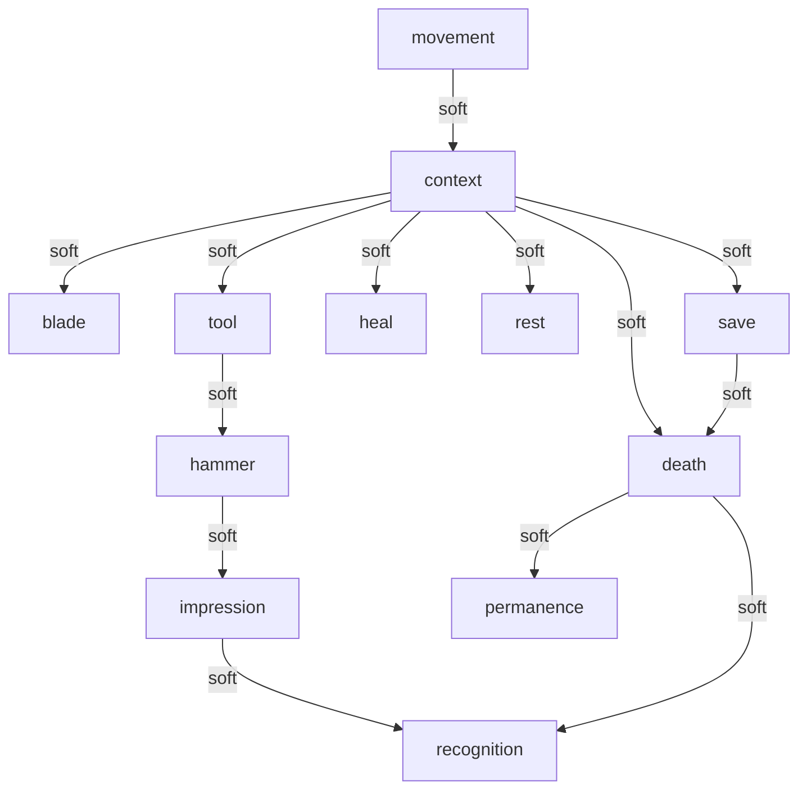

# Dependency graph

No edge is a hard gate. Lessons can be met in either era, in any order, including after an early death and after refusing the vein.

## Edges

- **movement → context** (soft). Most verbs belong to a place you can stand next to. The hands are available without a step.
- **context → blade** (soft). The blade is a verb on cord, root, cuff, or slab. Refusing all of them still lets the county continue.
- **context → tool** (soft). Hammer, salve, and cuff are used on something, not selected from a bar.
- **tool → hammer** (soft). The hammer rule is a particular use. The yard block and the vein seam are alternates.
- **hammer → impression** (soft). The vein face, once opened, is the way in. Skipping the impression does not block the shore.
- **impression → recognition** (soft). The coat in the stone is one way to know the later county. The milepost, the ruts, Ione, Hart, the window, and the ledger are others.
- **context → heal** (soft). Salve, well, cuff, or resting while hurt. None is required before the shore.
- **context → rest** (soft). Banks, hearth, ledge, river. Rest writes a quiet session notch and does not teach the save verb.
- **context → save** (soft). The ledger and the wayside stone. A long break still resumes if the session was notched by rest or by leaving.
- **context → death** (soft). Any lethal place. Dying early does not erase the teachers; it moves the county.
- **death → permanence** (soft). Release keeps scars, cuts, the open face, the coat, and an aged notch. Resume does not rewind the release.
- **death → recognition** (soft). The altered county is entered by release. Knowing it is a look or a sentence, not a banner.
- **save → death** (soft). A notch is continuity across a break. It is not an undo of release.

## Hammer rule

Only a hammer blow on the pale thread opens a marble face. A blade scars the face, and the scar stays through the year-shift. A hammer on the face raises dust and does not open. Hands can feel the thread and nothing more. The opened face in Marble Vein is the way to the impression. Soll's practice block obeys the same rule and opens nothing beyond itself.

Teachers that can stand in for each other:

- Blade: twine, root, slab wedge, cuff, or cutting a face.
- Hammer rule: Marble Vein seam, or Soll's practice block. Only the vein opens the impression.
- Heal: salve, well, cuff, or resting while hurt.
- Save: ledger or wayside stone. Rest and leaving the page write a session notch and do not teach the verb.
- Death: ditch, river, vein drop, airless cut, slab, or enough briars.
- Recognition: shifted ruts, milepost, Ione, Hart, the window, the ledger, or the impression once the coat matches.
